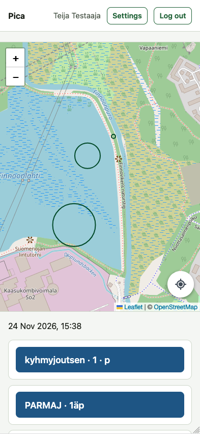
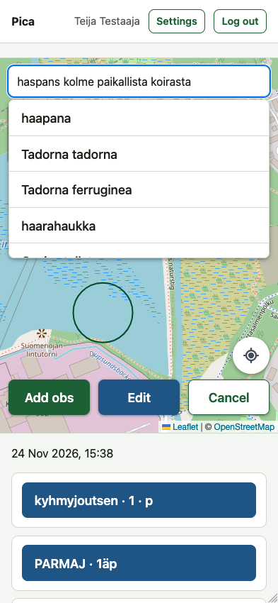
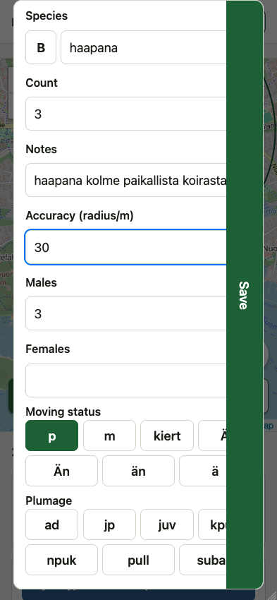
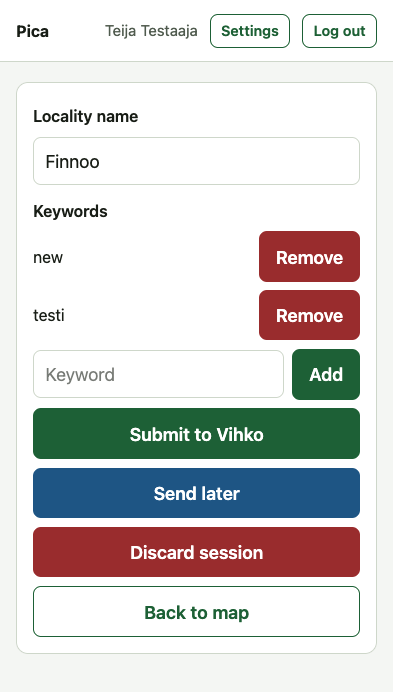

# Pica

Pica on selainkäyttöinen sovellus luontohavaintojen nopeaan kirjaamiseen maastossa. Retken havainnot tallennetaan puhelimeen ja lähetetään yhtenä havaintoeränä Lajitietokeskuksen Vihkoon.

Pica on kehitteillä ja saattaa muuttua varoittamatta. Sillä testataan uudenlaisia havaintojen tallennustapoja. Nämä ohjeet on päivitetty 24.11.2026.

Pican tekstit ovat toistaiseksi vain englanniksi. Alla painikkeet ja kentät on nimetty niin kuin ne näkyvät sovelluksessa.

Palautetta voi lähettää osoitteeseen mikko.heikkinen(ät)biomi.org.

## Kirjautuminen

Avaa Pica <https://pica.biomi.org> ja kirjaudu Havistin-sovelluksen kautta Laji.fi-tunnuksella.

Yläreunan Settings-painikkeesta voit säätää sovelluksen asetuksia. Erityisesti kannattaa huomata kolme eri moodia, joilla taksoninimen kirjaaminen toimii:

- A (All): Voit kirjata havaintoja kaikilla taksoneilla, jotka Lajitietokeskus tuntee.
- B (Birds): Lintulajien kirjaamiseen suunniteltu pikakirjoitumoodi.
- C (Custom): Voit kirjata havaintoja niistä taksoneista, jotka valitset asetuksista.

Sulje asetukset Close-napista.

## Karttanäkymä

**Start session** aloittaa retken nykyisestä sijainnistasi.

Lisätäksesi havainnon napauta karttaa havaintopaikkaan ja valitse **Add obs**, mikä avaa havaintolomakkeen (ks. alla).

Tallennetut havainnot näkyvät listana kartan alla uusin havainto ensin. Rivin painike avaa havainnon muokattavaksi. Voit myös valita kartalta havainnon muokattavaksi.

**End session** päättää retken (ks. alla).

**Karttanäkymässä havainnot ovat kartalla ympyröinä niiden tarkkuuden mukaan.**

## Pikasyöttö

Jos käytät moodia B, voit tallentaa lintuhavaintoja muutamalla painalluksella pikasyöttöä käyttäen. Napauta karttaa havaintopaikkaan. Tällöin kartan päälle avautuu lajinimikenttä, johon kursori on automaattisesti kohdistettu. Voit joko kirjoittaa lajinimen ja havainnon lisätiedot, tai paina näppäimistön puheentunnistusnappia ja sanella havainnon, esimerkiksi:

* punatulkku kymmenen paikallista
* sinisorsa kolme koirasta ja kaksi naartasta, muuttavat lounaaseen

Jos päätät kirjauksen tai sanelun sanaan `loppu`, havainto tallentuu automaattisesti. Nimen perässä oleva muu teksti menee kenttään **Notes** sekä tulkitaan automaattisesti tietokenttiin lukumäärästä, sukuolijakaumasta, liikkumisesta ja puvusta.

Tulkintaa varten kannattaa käyttää avainsanoja kuten paikallinen, muuttava, ääntelevä, laulava, koiras, naaras jne. Sovellus ei vielä ymmärrä havaintolyhenteitä kuten "3k ad jp p"

B-moodissa lajinimi tunnistetaan yleensä myös, vaikka sitä ei kirjoittaisi täysin oikein. Sovellus arvaa oikean lajinimen ottaen huomioon näppäimistöllä tavanomaisesti tehtävät virheet.

**Pikasyöttö: jos päätät havainnon sanaan "loppu", se tallentuu lajina haapana.**

## Havaintolomake

**Add obs** ja havainnon avaaminen luettelosta avaavat saman lomakkeen.

**Save** tallentaa. **Close** sulkee lomakkeen. Muokatessa **Change location** vaihtaa paikan ja **Delete** poistaa havainnon.

Lajinimikentän vieressä olevaa kirjainta napauttamalla voit vaihtaa tallennusmoodia. Näin voit nopeasti kirjata esim. kasvihavainnon ja sitten palata lintuhavaintojen kirjaamiseen.

## Lähetys Vihkoon

Sovellus muistaa käynnissä olevan havaintotapahtuman vaikka sulkisit selaimesi tai kirjautuisit välillä ulos. Selaimen muistin tyhjentäminen poistaa havainnot.

**End session** lopettaa retken ja avaa retken yleistiedot. Voit täydentää mm. paikannimen **Locality name** ja lisätä avainsanoja **Keywords**.

**Submit to Vihko** lähettää havainnot Vihkoon. Lähetyksen jälkeen havaintoja muokataan Vihkossa.

**Send later** jättää retken puhelimeen. Se näkyy aloitussivulla kohdassa **Unsent sessions**. **Back to map** palaa kartalle. **Discard session** hylkää retken, jolloin voit ladata havainnot puhelimeesi tiedostona.

